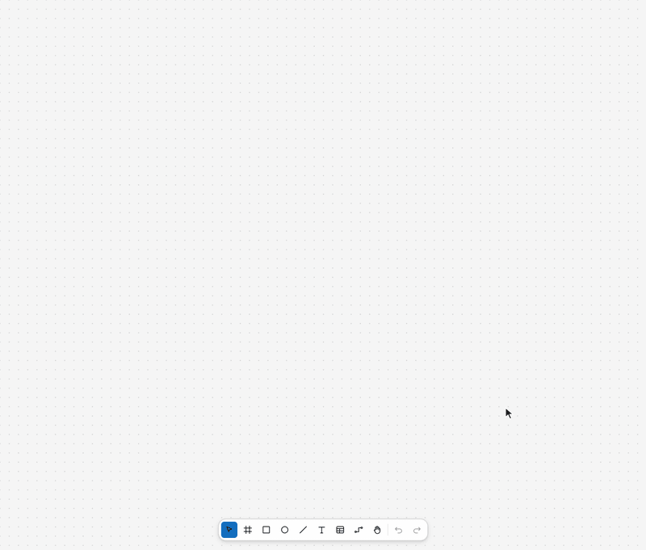
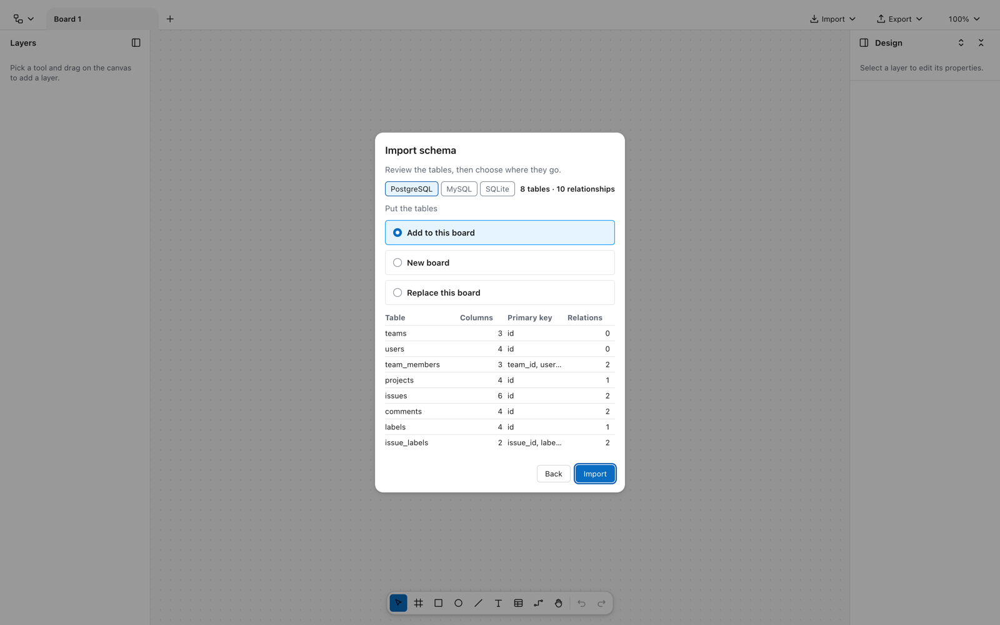
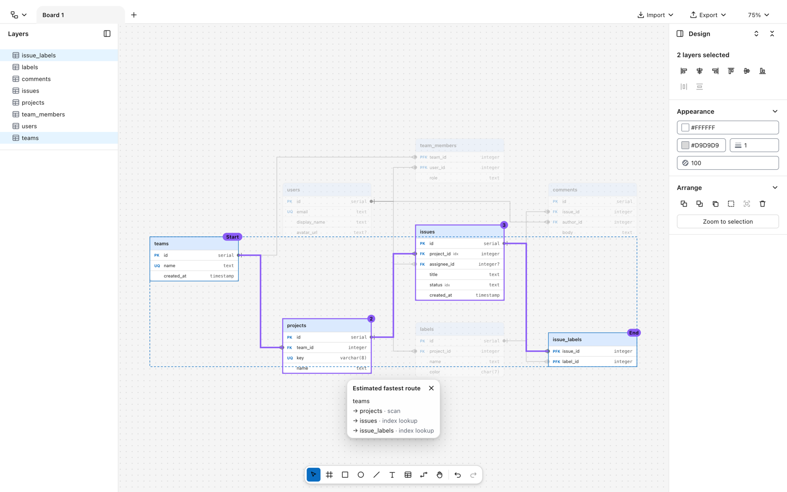
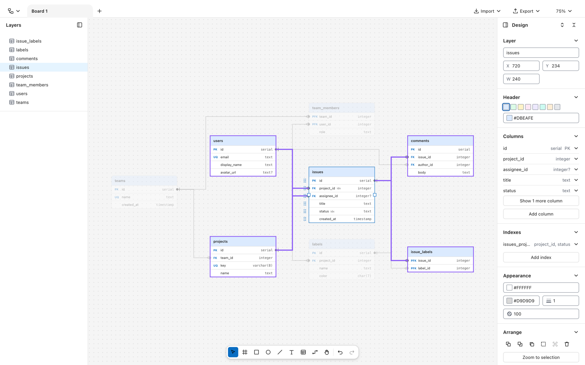
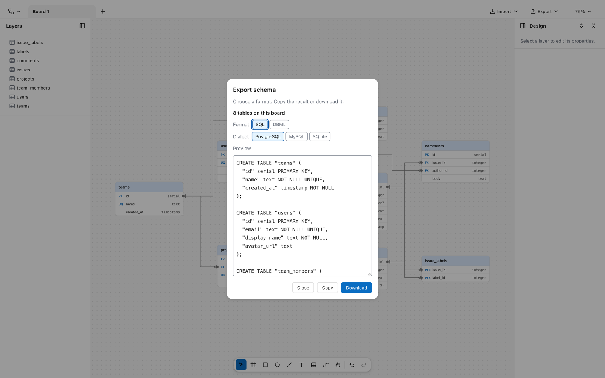
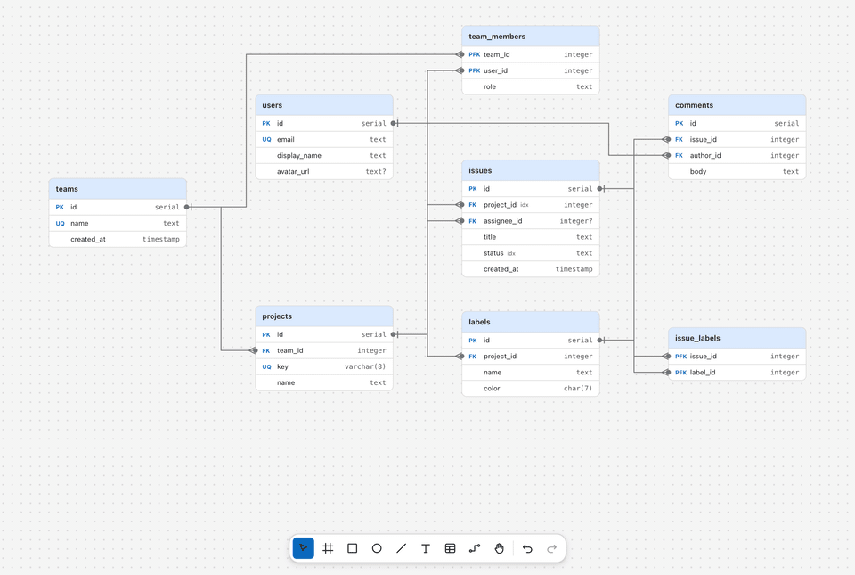

<div align="center">


# Draftboard

### Paste your schema. Get a diagram you can think with.

A database design canvas that runs entirely in your browser. Import SQL, DBML or a SQLite file,
watch the tables lay themselves out, and see at a glance which joins will be fast.
No account, no server, no network.


[Quick start](#-quick-start) ·
[Features](#-what-it-does) ·
[Full feature reference](docs/FEATURES.md) ·
[How it was built](#-how-it-was-built)

<br />



<sub>From one table to a whole schema. Fast-forwarded, of course.</sub>

</div>

---

## 🚀 Quick start

You need Node.js 26 ([`.nvmrc`](.nvmrc)) and npm 11+.

```bash
git clone https://github.com/wylando/draftboard.git
cd draftboard
npm install
npm run dev
```

Open **http://localhost:5173** and click **Try an example**, or paste your own schema from **Import → Schema**.

## ✨ What it does

### Bring the schema you already have

Paste PostgreSQL, MySQL or SQLite DDL, paste DBML, or open a `.sql`, `.dbml` or SQLite database file.
Draftboard detects the format, previews every table and relationship, and lays them out for you. It even
spots columns like `user_id` that *should* be foreign keys and offers them as guesses you can tick.
Files are read in your browser and never uploaded.

<picture>
  <source media="(prefers-color-scheme: dark)" srcset="docs/media/import-preview-dark.png" />
  
</picture>

### See which joins are fast

Select two tables and Draftboard highlights the cheapest join path between them. It knows which columns
are indexed, so a two-hop route through indexes can beat a direct scan. A popup lists every step as an
**index lookup** or a **scan**. When the fastest route might come up empty, it also offers a
**guaranteed route**, where every join is certain to find a matching row.

<picture>
  <source media="(prefers-color-scheme: dark)" srcset="docs/media/route-dark.png" />
  
</picture>

### Focus on one table, or ship it back out as SQL

<table>
<tr>
<td width="50%">

**Focus.** Select a table and its relationships and neighbours light up while everything else fades.
Crow's-foot markers, FK badges and type-mismatch warnings are all drawn on the canvas.

</td>
<td width="50%">

**Export.** Write the board (or just your selection) as PostgreSQL, MySQL or SQLite DDL, or as DBML.
Foreign keys, indexes and many-to-many junction tables are included. Copy it or download it.

</td>
</tr>
<tr>
<td>
<picture>
  <source media="(prefers-color-scheme: dark)" srcset="docs/media/focus-dark.png" />
  
</picture>
</td>
<td>
<picture>
  <source media="(prefers-color-scheme: dark)" srcset="docs/media/export-dark.png" />
  
</picture>
</td>
</tr>
</table>

### And a proper design canvas underneath

<p align="center">
  
  <br />
  <sub>Drag a table and every relationship reroutes around the others, live.</sub>
</p>

- **Lines that stay out of the way.** Right-angled connectors route around tables with as few bends as
  possible. Drag a segment to reshape one by hand.
- **Edit in place.** Double-click a cell to rename or retype a column, Tab to move on, and drag rows to
  reorder them. Indexes, unique keys and nullability are all there.
- **Semantic zoom.** Tables drop detail as you zoom out and become name cards at overview level, so a
  big schema stays readable.
- **Built for big boards.** Only the layers in view are drawn.
- **Shapes too.** Frames, rectangles, ellipses, lines, text, groups, smart guides, Alt-to-measure,
  align and distribute.
- **Boards as tabs.** Each board keeps its own undo history, selection and view. You can copy from one
  board and paste into another.
- **Keyboard first.** Every command can be remapped in Settings, and most have a default key.
- **Light and dark themes** that follow your system.
- **Private by default.** Autosaves to your browser, and boards export as JSON. There are no CDNs, web
  fonts, analytics or remote assets, so your schema never leaves your machine.

Want every detail, from crow's-foot markers to DBML type mapping? See the
**[full feature reference](docs/FEATURES.md)**, which also lists the tools and keyboard shortcuts.

## 🛠 Development

| Command | What it does |
| --- | --- |
| `npm run dev` | Dev server at http://localhost:5173 |
| `npm run build` | Typecheck and build to `dist/` |
| `npm run test:unit` | Vitest unit tests for the pure logic |
| `npm run test:e2e` | Cypress suite, headless, against the dev server |
| `npm run verify` | Everything CI runs |

<details>
<summary>All scripts, stack and project layout</summary>

<br />

| Command | Description |
| --- | --- |
| `npm run preview` | Serve the production build locally |
| `npm run lint` | ESLint (typescript-eslint + react-hooks), then the icon safety check |
| `npm run typecheck` | Typecheck the app and the test suite |
| `npm run test:coverage` | Unit tests; fails if coverage of the pure modules drops below the floor in `vite.config.ts` |
| `npm run test:e2e:dist` | Cypress against the production build (what CI runs) |
| `npm run test:e2e:burn` | Re-run each new or changed Cypress spec 5 times to catch flaky tests (`:dist` for the build) |
| `npm run cy:open` | Interactive Cypress (start `npm run dev -- --port 5199` first) |

**Stack.** [React 19](https://react.dev), [TypeScript](https://www.typescriptlang.org) (strict),
[Vite](https://vite.dev), [Panda CSS](https://panda-css.com) (type-safe tokens and recipes, with
`strictTokens`), [Ark UI](https://ark-ui.com) headless components, and SVG for the canvas. The schema
parsers ([@dbml/parse](https://www.npmjs.com/package/@dbml/parse) and
[sql.js](https://sql.js.org)) and the [dagre](https://github.com/dagrejs/dagre) layout are bundled and
load only when needed.

```
src/
├── app/              # Hash routing (editor ↔ settings), no router dependency
├── design-system/    # Panda theme (tokens, semantic tokens, recipes), UI primitives, dialogs, icons
├── editor/
│   ├── model/        # Document types, reducer with undo history, tables, connector routing, boards
│   ├── schemaImport/ # SQL / DBML / SQLite parsers, layout, conversion to table nodes
│   ├── schemaExport/ # SQL and DBML export
│   ├── hooks/        # Pointer gestures, keyboard shortcuts, viewport
│   ├── components/   # Canvas, selection overlay, panels, top bar, tool dock
│   ├── geometry.ts   # Pure math: transforms, resize, bounds, snapping
│   └── persistence.ts# localStorage (boards) + JSON import/export
├── settings/         # Command registry, keybindings, preferences, Settings page
└── shared/           # Small shared hooks
cypress/e2e/          # One spec per feature area
docs/                 # Feature reference, README media, reverse-engineering notes
```

**CI.** A pre-push hook (set up by `npm install`) runs lint, typecheck and unit tests in a few seconds.
On GitHub, every pull request into `main` runs **Lint & typecheck**, then **Build & E2E** against the
production build, then burns in the PR's new or changed specs.

</details>

## 🤝 Contributing

Issues and pull requests are welcome. Before you open a PR:

1. Follow the conventions in the surrounding code (architecture, Panda styling, test style).
2. Add a Cypress spec for any user-facing change and a colocated Vitest test (`*.test.ts`) for pure
   logic. Only add tests that catch a bug no other test catches;
   [`.claude/agents/test-reviewer.md`](.claude/agents/test-reviewer.md) explains what counts as
   redundant or flaky.
3. Make sure `npm run verify` passes.

Found a bug or have an idea? [Open an issue](https://github.com/wylando/draftboard/issues).
